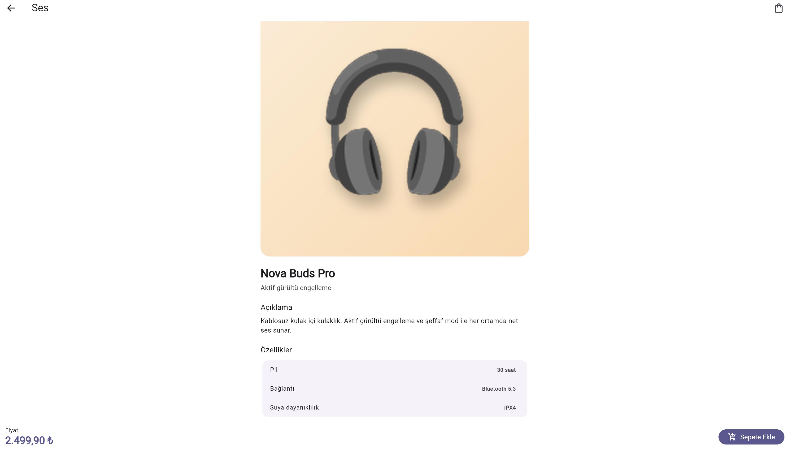
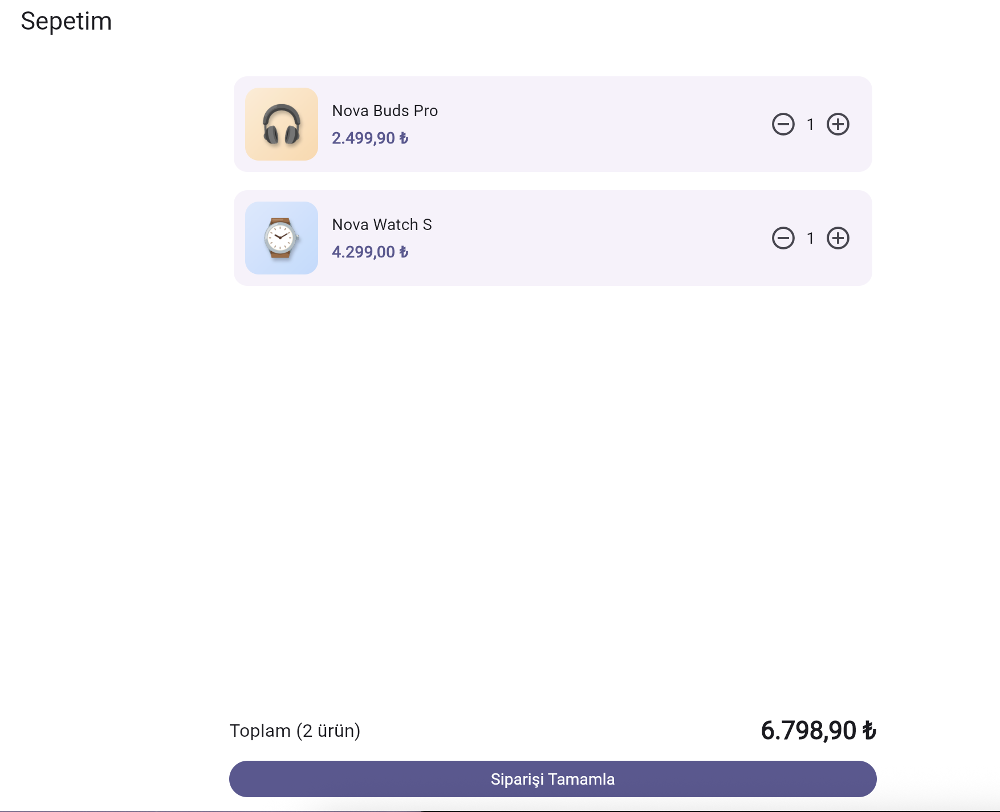
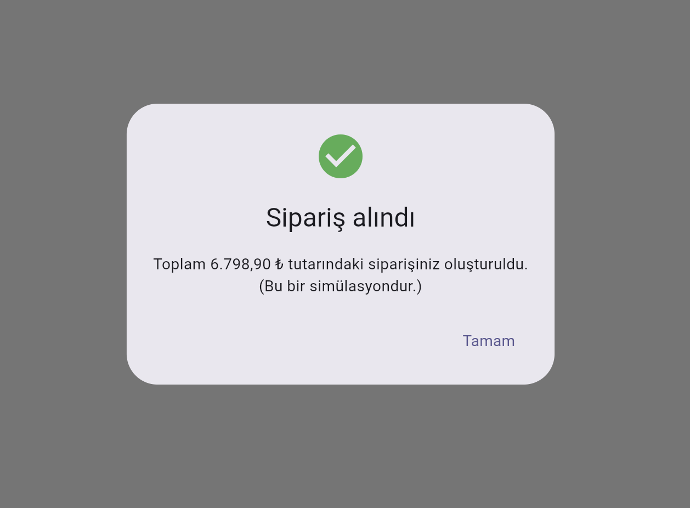

# Mini Katalog

Flutter ile geliştirilmiş, basit fakat profesyonel görünümlü bir **ürün katalog uygulaması**. Ürünler yerel bir JSON dosyasından (API simülasyonu) okunur, `GridView` ile kart şeklinde listelenir; ürün detayına `Navigator` ve route argument ile geçilir ve sepet işlemleri basit state güncellemesiyle yapılır.

## Kullanılan Flutter Sürümü

- **Flutter 3.50.0** (stable kanal)
- **Dart 3.13**
- Ekstra paket kullanılmamıştır; yalnızca `material.dart` ve Flutter SDK.

## Özellikler

- Ana sayfa: banner görseli, arama kutusu, kategori filtreleri
- `GridView` ile kart tabanlı ürün listesi
- Ürün detay sayfası (named route + `arguments` ile veri taşıma)
- Sepete ekleme, adet artırma/azaltma, toplam tutar hesaplama (simülasyon)
- `Product` model sınıfı (`fromJson` / `toJson`)
- Asset yönetimi: `Image.asset` ile görseller, `assets/data/products.json` ile veri

## Ekran Görüntüleri

| Ana Sayfa | Ürün Detayı | Sepet | Sipariş Onayı |
|---|---|---|---|
|  |  |  |  |

## Çalıştırma Adımları

1. Flutter SDK'nın kurulu olduğundan emin olun:
   ```bash
   flutter --version
   flutter doctor
   ```
2. Projeyi klonlayın:
   ```bash
   git clone https://github.com/lalekmc/mini_katalog.git
   cd mini_katalog
   ```
3. Bağımlılıkları yükleyin:
   ```bash
   flutter pub get
   ```
4. Android Emulator'ü başlatın (veya fiziksel cihaz bağlayın) ve uygulamayı çalıştırın:
   ```bash
   flutter run
   ```

## Proje Yapısı

```
lib/
├── main.dart                     # Uygulama girişi, tema ve route tanımları
├── models/
│   ├── product.dart              # Ürün modeli (fromJson / toJson)
│   └── cart.dart                 # Sepet ve sepet öğesi
├── services/
│   └── product_service.dart      # JSON verisinin okunması
├── screens/
│   ├── home_screen.dart          # Ana sayfa (arama, filtre, GridView)
│   ├── product_detail_screen.dart# Ürün detayı
│   └── cart_screen.dart          # Sepet
├── widgets/
│   ├── product_card.dart         # Ürün kartı
│   └── cart_button.dart          # Rozetli sepet butonu
└── utils/
    └── formatters.dart           # Fiyat biçimlendirme
assets/
├── data/products.json            # Ürün verileri (API simülasyonu)
└── images/                       # Banner ve ürün görselleri
```

## Not

Ürün verileri ve görseller eğitim/demo amaçlıdır; gerçek bir e-ticaret altyapısını temsil etmez.
